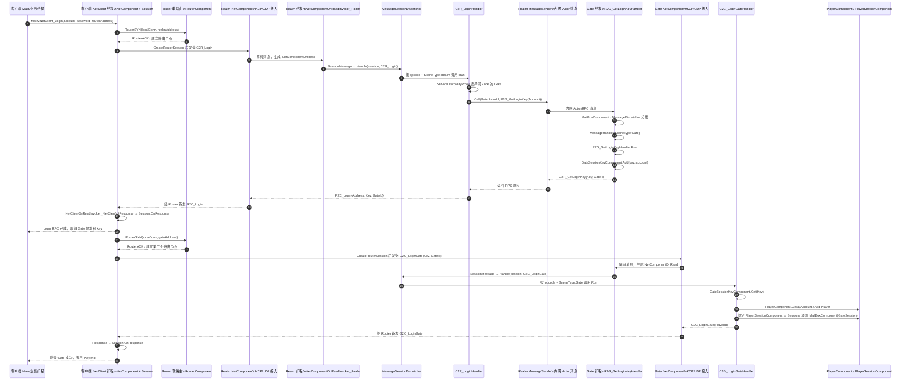

# ET 框架消息传递时序图：用户登录

下面以客户端调用 `LoginHelper.Login` 为例，展示一次“登录 Realm，取得 Gate 登录票据，再登录 Gate”的完整消息链路。图中把网络传输、软路由、Session、消息分发和业务 Handler 分开表示。

## 模块经过关系

| 阶段 | 主要模块 | 作用 |
| --- | --- | --- |
| 客户端入口 | `cn.etetet.login` / `Main2NetClient_LoginHandler` | 创建 Realm、Gate 两个 Session，串联登录步骤 |
| 软路由 | `cn.etetet.router` / `RouterComponent` | 将客户端外网连接映射到 Realm 或 Gate 的内网 KCP 连接 |
| 网络接入 | `cn.etetet.core` / `NetComponent`、`SessionSystem` | 收发字节、序列化消息、维护 RPC 回调 |
| Realm 入站 | `cn.etetet.login` / `NetComponentOnReadInvoker_Realm` | 将 `ISessionMessage` 交给会话消息分发器 |
| 会话分发 | `cn.etetet.core` / `MessageSessionDispatcher` | 依据 opcode 和场景类型选择 Handler |
| Realm 登录业务 | `C2R_LoginHandler` | 选择 Gate，并通过内网 RPC 请求登录 key |
| Realm→Gate 内网 | `MessageSender` + Gate `MessageDispatcher` | 按 Gate ActorId 投递 `R2G_GetLoginKey` |
| Gate 发票 | `R2G_GetLoginKeyHandler`、`GateSessionKeyComponent` | 生成临时 key 并记录 account 映射 |
| Gate 登录业务 | `C2G_LoginGateHandler` | 校验 key，创建/复用 Player，绑定 Gate Session |
| 客户端响应 | `NetClientOnReadInvoker_NetClient`、`Session.OnResponse` | 按 RpcId 唤醒等待中的 `Call` |

## 源码定位

- 客户端串联：`Packages/cn.etetet.login/Scripts/Hotfix/Client/NetClient/Main2NetClient_LoginHandler.cs`
- 客户端建路由 Session：`Packages/cn.etetet.login/Scripts/Hotfix/Client/NetClient/Router/RouterHelper.cs`
- Realm 入站与业务：`Packages/cn.etetet.login/Scripts/Hotfix/Server/Realm/NetComponentOnReadInvoker_Realm.cs`、`C2R_LoginHandler.cs`
- Gate 取 key 与登录：`Packages/cn.etetet.login/Scripts/Hotfix/Server/Gate/R2G_GetLoginKeyHandler.cs`、`C2G_LoginGateHandler.cs`
- 消息发送与 RPC 回调：`Packages/cn.etetet.core/Scripts/Hotfix/Share/Message/SessionSystem.cs`
- 会话消息分发：`Packages/cn.etetet.core/Scripts/Model/Share/Message/MessageSessionDispatcher.cs`
- Gate/Realm 网络初始化：`Packages/cn.etetet.login/Scripts/Hotfix/Server/Realm/FiberInit_Realm.cs`、`FiberInit_Gate.cs`

